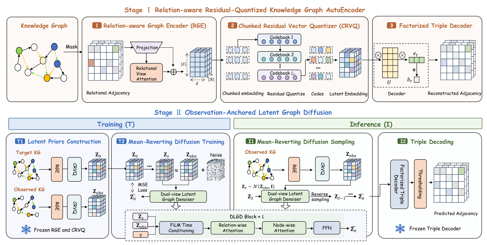

<div align="center">

# LatentDiff

### From Local Recovery to Unified Generation: Discovering Triple Set in Knowledge Graphs via Observation-Anchored Latent Diffusion

**A unified latent generative framework for knowledge graph triple set prediction**

<!-- [](https://arxiv.org/abs/2610.39114) -->

<!-- [**View on arXiv**](https://arxiv.org/abs/2610.39114) -->

</div>


## Overview

Triple set prediction (TSP) aims to recover a **set of missing relational triples** from an observed knowledge graph, rather than predicting isolated links. LatentDiff reformulates this task as conditional generation in a compact, globally shared latent space, avoiding the candidate restrictions and fragmented reasoning introduced by independent subgraph completion.

The framework has two stages:

1. **Relation-aware residual-quantized KG autoencoder.** Learn relation-specific latent representations from relational adjacency, quantize them with residual codebooks, and reconstruct triples through a factorized decoder.
2. **Observation-anchored latent graph diffusion.** Perturb the target latent toward the observed latent, then progressively recover missing relational information with a dual-view denoiser that models relation-wise and entity-wise dependencies.

## Method

<p align="center">
  
</p>

<p align="center">
  <sub><b>Method overview.</b> Stage I learns a relation-aware residual-quantized latent space; Stage II performs observation-anchored latent diffusion and triple decoding.</sub>
</p>

### Highlights

- **Unified graph modeling:** represent all head–relation contexts in one shared latent space instead of completing isolated subgraphs.
- **Relation-aware representation:** use relational-view attention and residual quantization to preserve multi-relational structure.
- **Observation anchoring:** use the observed graph as the diffusion reference rather than an unconditional Gaussian prior.
- **Dual-view denoising:** exchange information across relations and entities with linear attention and feed-forward blocks.
- **Memory-conscious execution:** process head entities in chunks without training separate local models.

## Repository Structure

```text
LKGDiff/
├── assets/
│   └── lkgdiff-method.png   # Method overview
├── config/
│   ├── stage1.yaml          # CFamily Stage-I configuration
│   ├── stage2.yaml          # CFamily Stage-II configuration
│   ├── stage1_wiki79.yaml   # Wiki79k configuration
│   └── stage1_wiki143.yaml  # Wiki143k configuration
├── script/
│   ├── run.py               # Stage-I autoencoder training
│   └── run_diff.py          # Stage-II diffusion training and evaluation
└── ultra/
    ├── stage12.py           # Encoder, RVQ, latent autoencoder, and triple decoder
    ├── diffnew1.py          # Conditional diffusion model and denoiser
    ├── datasets.py          # Transductive dataset loader
    └── util.py              # Configuration and training utilities
```

## Getting Started

> **Dataset setup.** Set `dataset.root` in the configuration files to your local dataset directory before running training. Some configurations contain placeholder paths such as `XXX`.

### Requirements

- Python 3.9+
- PyTorch
- PyTorch Geometric
- NumPy
- TensorBoard
- PyYAML, Jinja2, and EasyDict

### 1. Prepare a configuration

| Dataset | Configuration | Entities | Base relations |
|:---|:---|---:|---:|
| CFamily | `config/stage1.yaml` | 2,378 | 12 |
| Wiki79k | `config/stage1_wiki79.yaml` | 7,983 | 85 |
| Wiki143k | `config/stage1_wiki143.yaml` | 13,928 | 109 |

Set `dataset.root` to the dataset location. The configured `model.relation_model.num_relation` includes reverse relations and is therefore twice the base relation count.

### 2. Stage I — train the KG autoencoder

```bash
CUDA_VISIBLE_DEVICES=0 python script/run.py --config config/stage1.yaml --gpus '[0]'
```

For Wiki79k or Wiki143k, replace the configuration path accordingly. Stage I keeps `model_best.pth`, replacing it only when validation F1 improves. The checkpoint includes the epoch and best F1.

### 3. Stage II — train observation-anchored diffusion

Set the dataset path and the top-level checkpoint path in `config/stage2.yaml`:

```yaml
checkpoint: /absolute/path/to/model_best.pth
```

Then run:

```bash
CUDA_VISIBLE_DEVICES=0 python script/run_diff.py --config config/stage2.yaml --gpus '[0]'
```

Stage II loads and freezes the Stage-I autoencoder, trains the diffusion model, and evaluates triple-set predictions. It saves `diffusion_best.pth` and `diffusion_last.pth`; evaluation records are written to `metrics.jsonl`. TensorBoard logs are written under `runs/vqdiff` and `runs/vqdiff_tokens` for the two stages, respectively.

## Citation

If you find this work useful, please cite:

```bibtex
@article{wang2026local,
  title={From Local Recovery to Unified Generation: Discovering Triple Set in Knowledge Graphs via Observation-Anchored Latent Diffusion},
  author={Wang, Jiaqi and Gao, Yisen and Shi, Huayang and Hou, Junhao and Li, Wengen and Guan, Jihong and Zhang, Yichao and Zhou, Shuigeng and Song, Yangqiu and Cheng, Hong},
  journal={arXiv preprint arXiv:2610.39114},
  year={2026}
}
```
